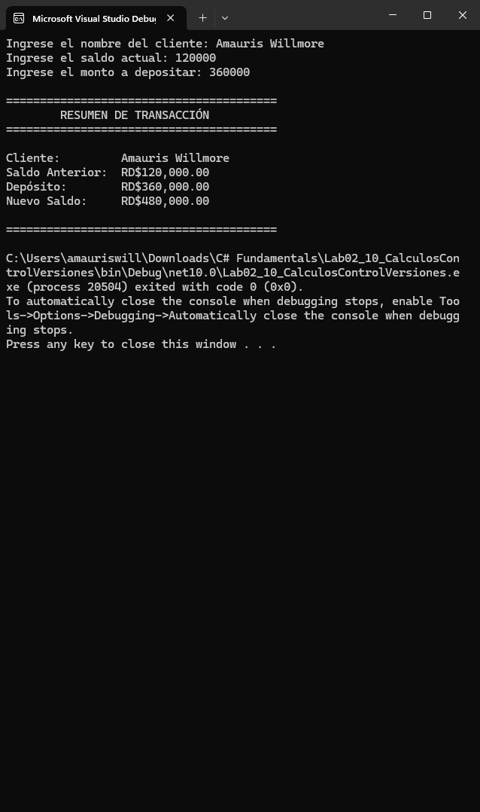

# Laboratorio 2.10 — Cálculos y Control de Versiones

Aplicación de consola en C# (.NET 10) orientada al registro y cálculo de depósitos bancarios, aplicando principios de Clean Code y control de versiones con Git.

## Captura de Ejecución

